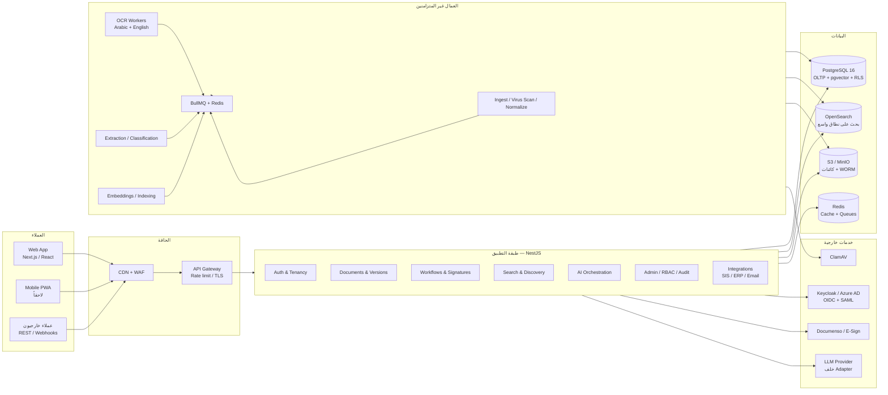
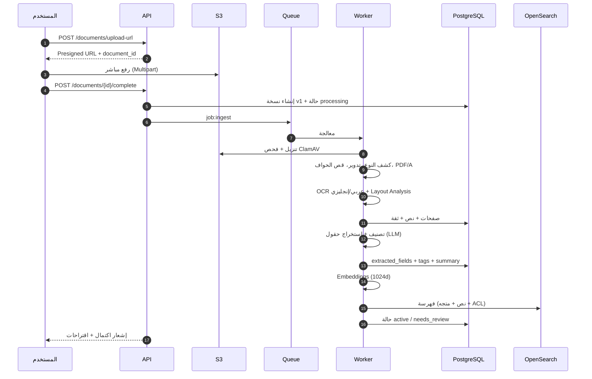

# أرشيفكس / Archifex — معمارية النظام

> **الإصدار:** 1.0 · **الحالة:** مقترح للتنفيذ (MVP) · **الجمهور:** فريق الهندسة، الإدارة التقنية، الأمن السيبراني
>
> **الهدف:** نظام أرشفة وإدارة مستندات ذكي متعدد المستأجرين (Multi-Tenant)، ثنائي اللغة عربي/إنجليزي، يخدم المؤسسات التعليمية والشركات، مع OCR عربي وإنجليزي، بحث دلالي ولغوي، استخراج بيانات بالذكاء الاصطناعي، صلاحيات دقيقة، سير عمل وتوقيع رقمي، وسجل تدقيق غير قابل للعبث.

---

## 1. المبادئ المعمارية

| المبدأ | التطبيق العملي |
|---|---|
| **Monolith أولاً، خدمات عند الحاجة** | NestJS Modular Monolith بوحدات واضحة الحدود. فصل خدمة OCR/الاستخراج إلى Worker مستقل منذ اليوم الأول لأنها ثقيلة وغير متزامنة. |
| **المستند هو وحدة الحقيقة** | كل شيء (OCR، الحقول المستخرجة، الإصدارات، التوقيعات، سير العمل) مرتبط بـ `document_id` + `version_id`. |
| **الأمان بالتصميم** | عزل مستأجرين عبر RLS، تشفير أثناء النقل والتخزين، روابط موقّعة قصيرة العمر، Least Privilege، وتدقيق شامل. |
| **العربية مواطن أول** | RTL أصلي، فهارس نصية عربية، تطبيع الحروف، وبيانات وصفية ثنائية اللغة في كل كيان. |
| **الذكاء الاصطناعي مساعد لا حاكم** | كل استخراج يحمل درجة ثقة؛ القرار النهائي للبشر في المستندات الحساسة، مع إمكانية التحقق والتعديل. |
| **قابلية التتبع** | كل عملية كتابة تُنتج حدث تدقيق، ولكل حدث `request_id` و`correlation_id`. |
| **التوسع الأفقي** | تطبيق عديم الحالة (Stateless)، مهام غير متزامنة، تخزين كائنات، وقراءة موزعة عند الحاجة. |
| **قابلية الاستبدال** | محرّك OCR، مزوّد التوقيع، ومزوّد LLM خلف واجهات (Adapters) قابلة للتبديل. |

---

## 2. المخطط العام عالي المستوى



### 2.1 مسار المستند من الرفع إلى البحث



**ضمانات المسار:**
- الرفع المباشر إلى S3 يمنع تحميل الخادم بالملفات الكبيرة.
- كل مهمة `idempotent` بمفتاح `(version_id, stage)`؛ إعادة التشغيل لا تكرر النتائج.
- فشل أي مرحلة ينقل المستند إلى `needs_review` مع سبب واضح، ولا يفقده.
- حد أقصى افتراضي: 200 MB / 2,000 صفحة لكل ملف (قابل للتهيئة لكل مستأجر).

---

## 3. حزمة التقنيات

| الطبقة | الاختيار | السبب | بديل مدروس |
|---|---|---|---|
| **الواجهة** | Next.js 15 (App Router) + React 19 + TypeScript | SSR للوحة، RSC للأداء، نظام توجيه ناضج | Vite SPA إذا كان الفريق صغيراً |
| **التصميم** | Tailwind CSS 4 + shadcn/ui + Radix | مكونات قابلة للوصول، RTL منطقي، تخصيص كامل | MUI (أثقل بصرياً) |
| **الحركة** | Framer Motion (محدود) | انتقالات دقيقة دون إثقال | CSS transitions فقط |
| **الخادم** | NestJS 11 + TypeScript | وحدات واضحة، DI، دعم أول للـ Workers والـ Guards | Fastify خام، .NET، Laravel |
| **API** | REST (OpenAPI 3.1) + Webhooks | بساطة التكامل مع الأنظمة الجامعية | GraphQL للقراءة فقط لاحقاً |
| **قاعدة البيانات** | PostgreSQL 16 | معاملات، JSONB، RLS، `pg_trgm`، `pgvector` | MySQL (أضعف في RLS/JSONB) |
| **البحث** | PostgreSQL FTS + `pg_trgm` في MVP، OpenSearch عند التوسع | تقليل التعقيد مبكراً | OpenSearch من اليوم الأول (كلفة تشغيل) |
| **المتجهات** | `pgvector` (HNSW) | بحث دلالي داخل نفس المعاملة والصلاحيات | Pinecone / Qdrant |
| **التخزين** | S3-compatible (AWS S3 / MinIO) | Presigned URLs، Versioning، Object Lock | Azure Blob |
| **الطوابير** | Redis 7 + BullMQ | مهام فورية ومجدولة، إعادة محاولة، أولويات | RabbitMQ / Kafka (لاحقاً للأحداث) |
| **الهوية** | Keycloak (OIDC/SAML) | SSO للمؤسسات، MFA، ربط Azure AD/Google | Auth0 / Clerk |
| **OCR** | Tesseract 5 (ara+eng) + PaddleOCR/Surya للجودة العالية | مجاني، يعمل On-Prem، دعم عربي جيد | Azure Document Intelligence / Google Document AI |
| **الاستخراج** | LLM عبر Adapter + Structured Output + قواعد Regex مساندة | مرونة في أنواع المستندات | نماذج مخصصة (تحتاج بيانات) |
| **التوقيع** | Documenso (مفتوح المصدر) أو مزوّد معتمد | خيار Self-hosted وخيار امتثال | Adobe Sign |
| **المراقبة** | OpenTelemetry + Grafana + Loki + Tempo + Sentry | تتبع موحد عبر API والعمال | Datadog |
| **النشر** | Docker + Kubernetes (أو ECS) | توسع أفقي، Rolling updates | VM + PM2 للبداية |
| **CI/CD** | GitHub Actions + Trivy + Prisma Migrate | فحص أمني وآلي | GitLab CI |

---

## 4. حدود الوحدات (Modular Monolith)

```
apps/
  api/                    # NestJS HTTP
  worker/                 # نفس الكود، وضع Worker فقط
  web/                    # Next.js
packages/
  domain/                 # كيانات وقواعد العمل النقية
  db/                     # Prisma schema + migrations + RLS
  contracts/              # DTOs + OpenAPI types مشتركة
  ui/                     # مكونات التصميم
  config/                 # إعدادات مشتركة
```

| الوحدة | المسؤولية | لا تفعل |
|---|---|---|
| `identity` | المستأجرون، المستخدمون، العضويات، الأدوار | لا تعرف شكل المستند |
| `org` | الأقسام، البرامج، العملاء، المشاريع | لا تدير الصلاحيات |
| `documents` | المستندات، الإصدارات، المجلدات، الوسوم، ACL | لا تنفذ OCR |
| `ingestion` | الرفع، الفحص، التطبيع، تشغيل الخط الأنبوبي | لا تقرأ محتوى المستند |
| `ocr` | استخراج النص، التخطيط، الثقة | لا تصنّف المستند |
| `ai` | التصنيف، الاستخراج، التلخيص، المتجهات | لا تحفظ قراراً نهائياً بلا تدقيق |
| `search` | الفهرسة، الاستعلام، التصفية، الترتيب | لا تتجاوز صلاحيات المستند |
| `workflows` | القوالب، النسخ، المهام، SLA | لا توقّع نيابة عن أحد |
| `signatures` | الأظرف، الأحداث، التحقق | لا تخزن مفاتيح خاصة بنفسها |
| `audit` | الأحداث، سلسلة التجزئة، التصدير | لا يقبل تعديلاً أو حذفاً |
| `notifications` | البريد، داخل التطبيق، Web Push | لا يحتوي منطق أعمال |
| `integrations` | SIS/ERP، Webhooks، البريد الوارد | لا يخزن أسراراً بنص صريح |
| `admin` | الإعدادات، أنظمة الاحتفاظ، التقارير | لا يتجاوز RLS |

**قاعدة الاعتماد:** `documents` يمكنه استدعاء `audit` و`search` عبر أحداث/واجهات، ولا تستدعيه الوحدات الدنيا. الأحداث الداخلية عبر `EventEmitter2` الآن، وقابلة للتحول إلى Outbox + Kafka لاحقاً.

---

## 5. نموذج التعدد المستأجر (Multi-Tenancy)

### 5.1 الاستراتيجية

| النموذج | متى يُستخدم | العزل |
|---|---|---|
| **Shared schema + RLS** (الافتراضي) | SaaS للجامعات الصغيرة والمتوسطة والشركات | `tenant_id` في كل جدول + سياسات RLS إلزامية |
| **Schema per tenant** | عميل يطلب فصلاً منطقياً | Search path + migrations لكل Schema |
| **Dedicated DB/Cluster** | جهة حكومية أو متطلبات امتثال صارمة | عزل كامل، نفس الكود |

### 5.2 قواعد إلزامية

1. كل جدول أعمال يحمل `tenant_id NOT NULL`، وكل مفتاح فريد يبدأ به: `UNIQUE (tenant_id, ...)`.
2. RLS مفعّل و`FORCE ROW LEVEL SECURITY`، والسياسة تقرأ `current_setting('app.tenant_id')`.
3. طبقة الوصول تحقن `SET LOCAL app.tenant_id` و`app.user_id` في كل معاملة — لا تُترك للـ ORM.
4. المستخدم قد ينتمي لعدة مستأجرين؛ الجلسة تحمل مستأجراً واحداً نشطاً (Workspace Switcher).
5. التخزين: مفتاح الكائن يبدأ بـ `tenants/{tenant_id}/...`، وتشفير بمفتاح لكل مستأجر (KMS Envelope Encryption) للعملاء المميزين.
6. الوظائف الخلفية تعمل دائماً داخل سياق مستأجر صريح، ويُرفض أي Job بلا `tenant_id`.

### 5.3 مثال سياسة RLS

```sql
ALTER TABLE documents ENABLE ROW LEVEL SECURITY;
ALTER TABLE documents FORCE ROW LEVEL SECURITY;

CREATE POLICY documents_tenant_isolation ON documents
  USING (tenant_id = current_setting('app.tenant_id', true)::uuid)
  WITH CHECK (tenant_id = current_setting('app.tenant_id', true)::uuid);
```

> التفاصيل الكاملة في [`02-database-schema.md`](./02-database-schema.md) و[`../db/schema.sql`](../db/schema.sql).

---

## 6. خط أنابيب المعالجة الذكية

### 6.1 المراحل

| # | المرحلة | التقنية | المخرج | معيار النجاح |
|---|---|---|---|---|
| 1 | استلام | S3 Event / API | كائن خام + checksum | تطابق SHA-256 |
| 2 | فحص أمني | ClamAV + كشف Macros | نظيف / معزول | 100% للملفات المرفوعة |
| 3 | كشف النوع | `file-type` + magic bytes | MIME فعلي | رفض التنفيذيات |
| 4 | تطبيع | Ghostscript / pdfcpu / Sharp | PDF/A-2b + صور صفحات | نجاح ≥ 99% |
| 5 | OCR | Tesseract (`ara+eng`) أو Layout Model | نص لكل صفحة + bbox | CER ≤ 5% للنص المطبوع |
| 6 | تحليل التخطيط | LayoutParser / PP-Structure | كتل: عنوان، جدول، توقيع، ختم | — |
| 7 | تصنيف | LLM + قواعد + kNN على المتجهات | نوع المستند + ثقة | ≥ 85% دقة في أنواع MVP |
| 8 | استخراج | LLM Structured Output + Regex | حقول + ثقة + موضع | ≥ 90% للحقول الأساسية |
| 9 | تلخيص ووسوم | LLM | ملخص عربي/إنجليزي + وسوم | مراجعة بشرية عيّنية |
| 10 | متجهات | `text-embedding` متعدد اللغات | 1024d | Recall@10 ≥ 0.8 |
| 11 | فهرسة | Postgres FTS / OpenSearch | مستند قابل للبحث | زمن فهرسة < 30 ثانية |

### 6.2 اختيار محرك OCR

| السيناريو | المحرك | ملاحظات |
|---|---|---|
| مستندات مكتبية نظيفة (Digital PDF) | استخراج النص المدمج مباشرة | لا OCR، أسرع وأدق |
| ممسوحة بجودة متوسطة | Tesseract 5 `ara+eng` + معالجة مسبقة | افتراضي لتوازن الكلفة |
| جداول ونماذج معقدة | PaddleOCR / Surya + Layout | دقة أعلى، كلفة حسابية أكبر |
| مخطوطات أو جودة منخفضة | مزوّد سحابي (Azure DI) اختياري | لكل مستأجر، مع موافقة نقل البيانات |

**المعالجة المسبقة:** تصحيح الميل (Deskew)، إزالة الضوضاء، Binarization متكيف، قص الحواف، رفع الدقة إلى 300 DPI، وفصل الصفحات المزدوجة.

### 6.3 تطبيع النص العربي

قبل الفهرسة والبحث:
- توحيد `أ إ آ ٱ` → `ا`، `ى` → `ي`، `ة` → `ه` (للفهرس فقط، لا للعرض).
- إزالة التشكيل والتطويل.
- توحيد الأرقام العربية-الهندية `٠١٢` مع اللاتينية في حقل بحث مساعد.
- معالجة الهمزات واللام الشمسية/القمرية في analyser.
- الحفاظ على النص الأصلي في `ocr_text` للعرض والاستشهاد.

> **مهم:** لا يُستخدم التطبيع في العرض أو التوقيع أو البصمة؛ فقط في حقول البحث.

### 6.4 استخراج الحقول بالذكاء الاصطناعي

كل نوع مستند له مخطط (JSON Schema) في `document_types.ai_schema`:

```json
{
  "type": "academic_transcript",
  "fields": [
    { "key": "student_no", "type": "string", "required": true, "pattern": "^[0-9]{6,12}$" },
    { "key": "gpa", "type": "number", "minimum": 0, "maximum": 5 },
    { "key": "semester", "type": "string", "enum": ["First", "Second", "Summer"] }
  ]
}
```

**قواعد الحوكمة:**
- كل حقل يُخزَّن مع `confidence`, `page_no`, `bbox`, `model_version`, `source` (llm/rule/manual).
- إذا كانت الثقة < 0.75 أو الحقل إلزامي مفقود → المستند `needs_review`.
- لا يُعاد تدريب أي نموذج على بيانات عميل دون موافقة صريحة (Opt-in).
- إخفاء PII قبل إرسال أي نص لمزوّد خارجي (خيار `redact_before_llm`).
- تسجيل كل استدعاء LLM: النموذج، التوكنز، الكلفة، الإصدار، ورقم الطلب.
- مخرجات النموذج تُتحقق دائماً مقابل JSON Schema قبل الحفظ.
- **Fallback:** عند تعطل المزوّد، تُستخدم القواعد + Tesseract، ويبقى المستند قابلاً للبحث.

### 6.5 البحث الهجين

```
Query
  ├─ تطبيع عربي + كشف اللغة
  ├─ Lexical:  tsvector (simple/arabic) + pg_trgm  ─┐
  ├─ Semantic: embedding + HNSW (cosine)           ─┼─ Reciprocal Rank Fusion
  └─ Filters:  tenant, ACL, type, dept, dates      ─┘
                          ↓
                  Rerank (Cross-Encoder اختياري)
                          ↓
             نتائج + مقتطفات + إبراز + سبب المطابقة
```

- **ACL قبل الترتيب:** لا يُعاد أي مستند لا يملك المستخدم صلاحية `view` عليه، حتى لو طابق الاستعلام. تُحقن مرشحات الصلاحية في الاستعلام نفسه.
- **البحث داخل المستند:** يُرجع رقم الصفحة ومربع الإحداثيات لتظليل النتيجة.
- **البحث بالعبارة الدقيقة** عبر `phraseto_tsquery`، و**البحث الضبابي** عبر `similarity()`.
- **المرادفات:** قاموس لكل مستأجر (مثال: «شهادة تخرج» = «وثيقة تخرج» = «دبلوم»).
- **OpenSearch** يُستخدم عندما يتجاوز حجم النص عشرات الملايين من الصفحات أو عند الحاجة إلى تحليلات متقدمة.

---

## 7. الأمان والامتثال

### 7.1 المصادقة والجلسات

| البند | القرار |
|---|---|
| البروتوكول | OIDC (Authorization Code + PKCE) وSAML 2.0 للمؤسسات |
| المزوّد | Keycloak Self-hosted أو Azure AD / Google Workspace |
| الجلسة | Access Token قصير (15 دقيقة) + Refresh Token دوّار (7 أيام) |
| التخزين | كوكيز `HttpOnly; Secure; SameSite=Lax` — لا `localStorage` للتوكن |
| MFA | TOTP + WebAuthn، إلزامي للأدوار الإدارية |
| كلمات المرور | Argon2id إن لم يوجد SSO |
| الجلسات المتزامنة | حد أقصى قابل للتهيئة + إبطال فوري |

### 7.2 التفويض

- **RBAC** للأدوار الأساسية: `Admin`, `Manager`, `Editor`, `Viewer`, `Auditor` (قراءة سجل فقط).
- **ABAC** للسياقات: القسم، المشروع، سرية المستند، الفترة الزمنية، الملكية.
- **ACL على المستند** لتجاوزات محددة (مشاركة فردية مؤقتة).
- **قاعدة الرفض تتغلب:** إن تعارض منح الدور مع قيد سرية، يُرفض.
- **فصل الواجبات:** من ينشئ المستند لا يعتمده في سير العمل الحساس (قابل للتهيئة).
- **التحقق في الخادم فقط:** إخفاء زر في الواجهة ليس صلاحية.

مصفوفة مختصرة:

| الإجراء | Admin | Manager | Editor | Viewer | Auditor |
|---|:--:|:--:|:--:|:--:|:--:|
| عرض مستند عادي | ✅ | ✅ | ✅ | ✅ | ✅ |
| رفع/تعديل | ✅ | ✅ | ✅ | ❌ | ❌ |
| حذف/استعادة | ✅ | ✅ | ❌ | ❌ | ❌ |
| إدارة المستخدمين | ✅ | جزئي | ❌ | ❌ | ❌ |
| اعتماد سير عمل | ✅ | ✅ | ❌ | ❌ | ❌ |
| تصدير سجل التدقيق | ✅ | ❌ | ❌ | ❌ | ✅ |
| عرض مستند «سري» | ✅ | حسب القسم | حسب القسم | ❌ | ✅ (قراءة) |

### 7.3 حماية البيانات

| التهديد | الضابط |
|---|---|
| تسرب بين المستأجرين | RLS + اختبارات عزل آلية + مراجعة استعلامات |
| روابط تخزين مسربة | Presigned URLs ≤ 5 دقائق، وربطها بالمستخدم |
| ملفات خبيثة | ClamAV + Sandbox + رفض Macro-enabled بلا موافقة |
| اعتراض النقل | TLS 1.3، HSTS، شهادات داخلية لخدمة-خدمة |
| وصول غير مصرح | OIDC + MFA + جلسات قصيرة + Rate limiting |
| تسريب بيانات في السجلات | تنقية PII، عدم تسجيل النصوص الكاملة |
| حذف عرضي | Soft delete + سلة محذوفات 30 يوماً + PITR 35 يوماً |
| تلاعب بالتدقيق | Append-only + سلسلة Hash + تصدير WORM دوري |
| فقدان مفتاح | KMS + نسخ مفاتيح في HSM/Region مختلفة |
| إساءة استخدام AI | حد استهلاك لكل مستأجر + إخفاء PII + سجل prompts |

### 7.4 الامتثال

- **PDPL** (السعودية) و**GDPR** عند وجود مستخدمين أوروبيين: أساس قانوني، حق الوصول/الحذف، سجل معالجة.
- **الاحتفاظ:** سياسة لكل نوع مستند (`retention_months`)، مع `legal_hold` يمنع الحذف.
- **الإتلاف:** يتطلب موافقة مدير + سبب + تصدير شهادة إتلاف + حدث تدقيق.
- **الموقع:** خيار استضافة داخل المملكة (On-Prem أو Region محلي) للجهات الحساسة.
- **النسخ الاحتياطي:** RPO ≤ 15 دقيقة (WAL)، RTO ≤ 4 ساعات، اختبار استعادة ربع سنوي.
- **الاختراق:** خطة استجابة، إشعار خلال 72 ساعة عند الاشتباه، وسجل أدلة جنائي.

---

## 8. سير العمل والتوقيع الرقمي

### 8.1 محرك سير العمل

نموذج آلة حالات (State Machine) مُعرَّف في `workflow_templates.definition`:

```json
{
  "steps": [
    { "key": "review", "name_ar": "مراجعة القسم", "assignee": "role:manager", "sla_hours": 48 },
    { "key": "approve", "name_ar": "اعتماد المدير", "assignee": "user:uuid", "sla_hours": 24 },
    { "key": "sign", "name_ar": "التوقيع", "assignee": "signer", "sla_hours": 72 }
  ],
  "transitions": [
    { "from": "review", "on": "approve", "to": "approve" },
    { "from": "review", "on": "reject", "to": "cancelled" },
    { "from": "approve", "on": "approve", "to": "sign" }
  ]
}
```

**الميزات:** مسارات متوازية، تفويض مؤقت، تذكير تلقائي، تصعيد عند تجاوز SLA، وتعليق عند تعديل المستند (Invalidation).

### 8.2 التوقيع

- **داخلي:** توقيع إلكتروني بسيط (رسم/OTP) مع ختم زمني وبصمة SHA-256 للإصدار الموقّع.
- **متقدم/معتمد:** تكامل Documenso أو مزوّد معتمد (Qualified eSignature) عند الحاجة القانونية.
- التوقيع مرتبط بـ `version_id` + `document_hash`؛ أي تعديل لاحق يُبطل التوقيع ويُنشئ إصداراً جديداً.
- يُخزَّن: الشهادة، البصمة، IP، User-Agent، الوقت، وسجل الأحداث الكامل.

---

## 9. واجهات البرمجة والتكاملات

### 9.1 REST مختصر

| الطريقة | المسار | الوصف |
|---|---|---|
| `POST` | `/v1/documents/upload-url` | رابط رفع موقّع |
| `POST` | `/v1/documents/{id}/complete` | تأكيد الرفع وبدء المعالجة |
| `GET` | `/v1/documents` | قائمة مع تصفية وترقيم |
| `GET` | `/v1/documents/{id}` | تفاصيل + حقول + إصدارات |
| `PATCH` | `/v1/documents/{id}` | تعديل metadata |
| `POST` | `/v1/documents/{id}/versions` | إصدار جديد |
| `GET` | `/v1/search?q=` | بحث هجين مع facets |
| `POST` | `/v1/workflows/{id}/tasks/{taskId}/decision` | قرار |
| `POST` | `/v1/signatures/envelopes` | إنشاء ظرف توقيع |
| `GET` | `/v1/audit/events` | سجل تدقيق (Admin/Auditor) |
| `POST` | `/v1/webhooks` | تسجيل Webhook |

**معايير:** OpenAPI موثّق، ترقيم cursor، أخطاء RFC 9457، `Idempotency-Key` للكتابة، وحدود معدل لكل مفتاح.

### 9.2 التكاملات المستهدفة

| النظام | الاتجاه | الاستخدام |
|---|---|---|
| SIS (Banner / PeopleSoft / CSV) | سحب ليلي | الطلاب، البرامج، السجلات الأكاديمية |
| ERP (SAP / Odoo) | Webhook/API | العقود والفواتير والعملاء |
| Microsoft 365 / Google | رفع/حفظ | حفظ نسخ، إشعارات |
| البريد الإلكتروني | وارد | تحويل مرفقات إلى مستندات (مع مراجعة) |
| Active Directory / Azure AD | SSO + مزامنة | المستخدمون والأقسام |
| Documenso | API | التوقيع |
| Webhooks | صادر | إشعار الأنظمة عند الاعتماد/التوقيع |

---

## 10. تجربة المستخدم والتعريب

| البند | القرار |
|---|---|
| التوجيه | `next-intl` مع `ar` (افتراضي) و`en` |
| RTL | خصائص CSS منطقية (`margin-inline-start`, `inset-inline`, `text-align: start`) — لا `left/right` |
| الخطوط | IBM Plex Sans Arabic للعربية، Inter للإنجليزية، JetBrains Mono للأرقام والمراجع |
| الأرقام | عرض حسب اللغة، وتخزين دائماً بالأرقام اللاتينية |
| التواريخ | `Intl.DateTimeFormat` مع تقويم ميلادي افتراضي وخيار هجري |
| الملفات | دعم أسماء عربية، وتطبيع Unicode (NFC) قبل التخزين |
| الوصول | WCAG 2.2 AA، تنقل كامل بالكيبورد، `aria-live` للإشعارات، تباين ≥ 4.5:1 |
| الاتجاه المختلط | عزل النصوص اللاتينية داخل العربية بـ `<bdi>` لتجنب تشوه الترتيب |
| الثيم | فاتح/داكن مع حفظ التفضيل واحترام `prefers-color-scheme` |

---

## 11. الأداء وقابلية التوسع

### 11.1 أهداف SLO

| المقياس | الهدف |
|---|---|
| توفر API | 99.9% شهرياً |
| زمن استجابة `GET /documents` (p95) | < 400 ms |
| زمن البحث (p95) | < 700 ms |
| رفع 10 MB | < 5 ثوانٍ (حسب شبكة العميل) |
| بدء ظهور نتيجة OCR | < 60 ثانية لمستند 20 صفحة |
| فشل المهام | < 1% مع إعادة محاولة |
| RPO / RTO | 15 دقيقة / 4 ساعات |

### 11.2 التوسع

- API: Horizontal Pod Autoscaler على CPU + RPS.
- Workers: طوابير منفصلة (`ocr`, `ai`, `index`, `mail`) مع أولويات وحدود تزامن.
- OCR: GPU Node Pool اختياري؛ Tesseract على CPU يعمل بحد 2–4 صفحات متوازية لكل Pod.
- قاعدة البيانات: Read replicas للتقارير، Partitioning للتدقيق والصفحات، وأرشفة النصوص القديمة.
- التخزين: Lifecycle Policies (Standard → Infrequent → Archive) مع الحفاظ على WORM للمستندات الحرجة.
- الحدود: Quotas لكل مستأجر (تخزين، صفحات OCR، استدعاءات AI).

### 11.3 التخزين المؤقت

| المفتاح | TTL | ملاحظات |
|---|---|---|
| صلاحيات المستخدم | 5 دقائق | إبطال عند تغيير الدور |
| إعدادات المستأجر | 15 دقيقة | إبطال عند التعديل |
| نتائج البحث الشائعة | 60 ثانية | مع مراعاة ACL |
| توقيعات الملفات | 5 دقائق | لا تُخزَّن للأسرار |

---

## 12. النشر والتشغيل

### 12.1 البيئات

| البيئة | الغرض | البيانات |
|---|---|---|
| `local` | تطوير | Docker Compose + بيانات وهمية |
| `staging` | اختبار قبول | بيانات مُقنَّعة |
| `production` | العملاء | بيانات حقيقية، نسخ احتياطي |

### 12.2 المكونات (Kubernetes)

```yaml
# مختصر
web:       2–6 replicas
api:       2–10 replicas
worker:    2–20 replicas (طوابير متعددة)
postgres:  Managed (RDS/Cloud SQL) + PITR
redis:     Managed, Multi-AZ
opensearch: 3 nodes (اختياري في MVP)
minio/s3:  Bucket + Versioning + Object Lock
keycloak:  2 replicas + DB خاص
```

### 12.3 CI/CD

1. `lint` + `typecheck` + `unit` + `integration` (Testcontainers).
2. فحص أمني: `Trivy`, `npm audit`, `Semgrep`, فحص الأسرار.
3. بناء صور Docker موقّعة (Cosign) وSBOM.
4. migrations: `prisma migrate deploy` في Job منفصل قبل النشر.
5. نشر Canary 10% → مراقبة 15 دقيقة → 100%.
6. Rollback آلي عند تجاوز معدل الأخطاء.

### 12.4 المراقبة

- **Metrics:** زمن الطلب، معدل الأخطاء، عمق الطوابير، زمن OCR، كلفة AI، عدد المستندات العالقة.
- **Logs:** JSON منظم مع `tenant_id`, `request_id`, `user_id` (دون PII).
- **Traces:** OpenTelemetry عبر API → Queue → Worker → DB.
- **Alerts:** PagerDuty/Slack عند: فشل OCR > 5%، طابور > 500، DB connections > 80%، شهادة تنتهي خلال 14 يوماً.
- **Dashboards:** صحة النظام، استخدام المستأجرين، جودة الاستخراج، أداء البحث.

---

## 13. قرارات معمارية (ADRs)

| # | القرار | البديل المرفوض | السبب |
|---|---|---|---|
| ADR-01 | Modular Monolith + Worker منفصل | Microservices كاملة | تعقيد تشغيلي مبكر بلا فائدة في MVP |
| ADR-02 | PostgreSQL + RLS للتعدد | DB لكل مستأجر | كلفة وتشغيل؛ ننتقل للعزل الكامل للعملاء الكبار |
| ADR-03 | pgvector قبل OpenSearch | OpenSearch من البداية | كفاية حتى ملايين الصفحات، وتقليل الأجزاء |
| ADR-04 | Presigned Upload مباشر | رفع عبر API | أداء وكلفة أفضل للملفات الكبيرة |
| ADR-05 | OCR محلي افتراضي | سحابي فقط | خصوصية البيانات وكلفة متوقعة |
| ADR-06 | LLM خلف Adapter + Schema | الاعتماد على مزوّد واحد | قابلية التبديل والتكلفة |
| ADR-07 | Next.js + RSC | SPA | SEO للصفحات العامة وأداء اللوحة |
| ADR-08 | Keycloak | نظام هوية مخصص | أمان ناضج وSSO |
| ADR-09 | أحداث Outbox لاحقاً | Kafka الآن | لا حاجة قبل تعدد الخدمات |
| ADR-10 | Soft delete + Retention | حذف فوري | امتثال واستعادة |

---

## 14. المخاطر الفنية والتخفيف

| الخطر | الاحتمال | الأثر | التخفيف |
|---|---|---|---|
| دقة OCR العربي على ممسوحات رديئة | متوسط | مرتفع | معالجة مسبقة، خيار مزوّد سحابي، مراجعة بشرية |
| كلفة LLM تتجاوز التوقعات | متوسط | متوسط | تحديد أنواع المستندات، تخزين مؤقت، نماذج أصغر، Quotas |
| تسرب بيانات بين مستأجرين | منخفض | حرج | RLS + اختبارات عزل + مراجعة أمنية |
| بطء معالجة الطوابير | متوسط | متوسط | توسع أفقي، أولويات، فصل طابور OCR |
| تعقيد RTL في مكونات الطرف الثالث | مرتفع | منخفض | تغليف المكونات واختبارات بصرية |
| مقاومة التغيير في الجامعات | متوسط | مرتفع | تجربة تجريبية، تدريب، استيراد تدريجي |
| الاعتماد على مزوّد خارجي | متوسط | متوسط | Adapter + Fallback محلي |
| نمو البيانات بسرعة | متوسط | متوسط | Partitioning، Lifecycle، أرشفة |

---

## 15. ما بعد MVP (باختصار)

- تطبيق جوال (PWA ثم Native) مع مسح ضوئي.
- بحث متعدد الوسائط (صور، مخططات) وRAG للإجابة عن الأسئلة.
- كشف تلقائي للازدواج (Deduplication) بالـ checksum والمتجهات.
- تحليلات مؤسسية: لوحات امتثال، مؤشرات اكتمال الملفات.
- سوق إضافات (Marketplace) لأنواع مستندات وقوالب سير عمل.
- تشغيل متعدد المناطق (Multi-Region) للجهات الحكومية.

---

## 16. المراجع الداخلية

- [مخطط قاعدة البيانات](./02-database-schema.md)
- [الهوية البصرية والواجهة](./03-ui-brand-wireframe.md)
- [خطة MVP](./04-mvp-roadmap.md)
- [DDL جاهز للتنفيذ](../db/schema.sql)
