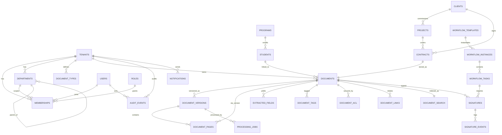
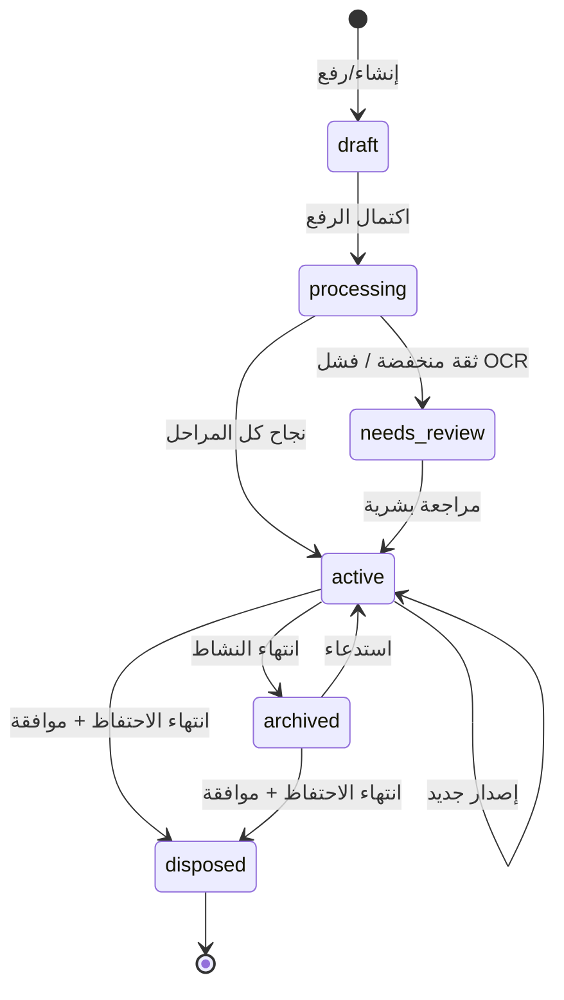

# أرشيفكس / Archifex — تصميم قاعدة البيانات

> **الإصدار:** 1.0 · **المحرك:** PostgreSQL 16 · **الملف التنفيذي:** [`../db/schema.sql`](../db/schema.sql)
>
> يشرح هذا المستند *لماذا* صُممت المخططات بهذا الشكل، بينما يبقى ملف SQL هو المصدر النهائي للحقيقة (Source of Truth).

---

## 1. الاصطلاحات العامة

| القاعدة | التفصيل |
|---|---|
| **المفاتيح** | `uuid` مع `gen_random_uuid()` لكل الكيانات الأساسية؛ `bigserial` للجداول ذات الحجم الكبير (الصفحات، أحداث التدقيق). |
| **العزل** | `tenant_id NOT NULL` في كل جدول أعمال، وكل قيد فريد يبدأ به. |
| **التعريب** | أعمدة `name_ar` و`name_en` منفصلة، وليس JSON، لدعم الفرز والبحث والفهرسة. |
| **الحذف** | `deleted_at` للمستندات والمجلدات (استعادة 30 يوماً). الجداول الارتباطية تُحذف تتابعياً. |
| **الوقت** | `timestamptz` بتوقيت UTC دائماً؛ التحويل للعرض في التطبيق. |
| **المال** | `numeric(18,2)`، والعملة `char(3)` (SAR, USD...). لا `float`. |
| **JSONB** | للبيانات المرنة فقط (metadata، تعريف سير العمل، التخطيط). لا يُستخدم بديلاً عن الأعمدة التي تُستعلم كثيراً. |
| **القوائم** | `text[]` للوسوم، مع فهرس GIN. |
| **البصمات** | `bytea` أو `char(64)` لـ SHA-256، ولا تُخزَّن بيانات الهوية الوطنية نصاً صريحاً. |

---

## 2. المخطط الكياني (ERD)



---

## 3. كتالوج الجداول

### 3.1 المستأجرون والهوية والتنظيم

| الجدول | الغرض | أهم الأعمدة / القيود |
|---|---|---|
| `tenants` | جذر العزل | `slug` فريد، `kind`, `plan`, حصص التخزين/OCR/AI، `settings jsonb` |
| `tenant_domains` | نطاقات البريد المرتبطة | `domain citext UNIQUE`, `verified_at` |
| `users` | هوية عالمية للمستخدم | `email citext UNIQUE`, `idp_subject UNIQUE`, `locale`, `mfa_enabled` |
| `roles` | أدوار لكل مستأجر | `UNIQUE (tenant_id, key)`, `permissions jsonb` |
| `memberships` | ربط المستخدم بالمستأجر | `PK (tenant_id, user_id)`, `role_id`, `department_id`, `status` |
| `departments` | هيكل تنظيمي شجري | `path ltree`, `UNIQUE (tenant_id, path)`, `manager_id` |
| `notifications` | إشعارات داخل التطبيق | `is_read`, `kind`, `link` |
| `saved_searches` | بحث محفوظ | `query jsonb`, `is_shared` |
| `api_keys` | تكاملات آلية | `key_prefix UNIQUE`, `key_hash bytea`, `scopes[]` |
| `webhooks` | أحداث صادرة | `events[]`, `secret_encrypted`, `is_active` |

**لماذا `users` عالمي و`memberships` منفصل؟**
المستخدم قد يعمل في جامعة وشركة في نفس المنصة. الفصل يمنع تكرار الهوية، ويجعل تبديل مساحة العمل (Workspace Switch) مجرد تغيير `tenant_id` في الجلسة. الصلاحيات والأقسام تبقى داخل العضوية.

### 3.2 النطاق التعليمي

| الجدول | الغرض | ملاحظات |
|---|---|---|
| `academic_years` | الأعوام الدراسية | `is_current` واحد لكل مستأجر (يُضمن تطبيقياً) |
| `programs` | البرامج/التخصصات | مرتبط بقسم، `degree_level`, `total_credits` |
| `students` | السجلات الطلابية | `student_no` فريد داخل المستأجر، `national_id_hash`، `gpa` مع قيد 0–5 |
| `documents.student_id` | ربط المستند بالطالب | كشوف الدرجات، الشهادات، خطابات التعريف |

**قرار:** لا نُنشئ جدول `transcripts` منفصلاً في MVP. كشف الدرجات هو *مستند* من نوع `academic_transcript`، وحقوله (GPA، الفصل، الساعات) تُستخرج في `extracted_fields`. هذا يمنع ازدواج الحقيقة بين نظام SIS والأرشيف. عند الحاجة لتقارير أكاديمية ثقيلة، تُضاف جداول مشتقة (Materialized Views) من SIS.

### 3.3 النطاق المؤسسي

| الجدول | الغرض | ملاحظات |
|---|---|---|
| `clients` | العملاء | `tax_number` للفواتير، جهات الاتصال |
| `projects` | المشاريع | مرتبط بعميل ومدير، ميزانية وعملة |
| `contracts` | العقود والاتفاقيات | `contract_no` فريد، تواريخ، قيمة، `document_id` |
| `documents.client_id/project_id` | ربط المستندات | فواتير، عروض، SLAs، مواصفات |

**قرار:** الفواتير وعروض الأسعار (RFPs) تُدار كمستندات + حقول مستخرجة، وليس كجداول محاسبية. النظام أرشيف وليس ERP؛ التكامل مع ERP يحافظ على مصدر واحد للمحاسبة.

### 3.4 المستندات — القلب

| الجدول | الغرض | أهم الأعمدة |
|---|---|---|
| `document_types` | قوالب الأنواع | `key` فريد لكل مستأجر، `ai_schema jsonb`, `retention_months`, `requires_signature` |
| `folders` | شجرة مجلدات | `path ltree`, `UNIQUE (tenant_id, path)` |
| `documents` | السجل الرئيسي | `status`, `confidentiality`, `current_version_id`, `tags[]`, `metadata`, `legal_hold`, `classification_confidence` |
| `document_versions` | كل رفع/تعديل | `version_no`, `storage_key`, `checksum`, `ocr_status` |
| `document_pages` | نص وموضع كل صفحة | `ocr_text`, `ocr_confidence`, `layout jsonb`, `embedding` |
| `document_search` | سطح البحث الموحّد | `tsv` مولّد، `embedding vector(1024)` |
| `extracted_fields` | الحقول الذكية | `field_key`, `value_text/json`, `confidence`, `bbox`, `verified_by` |
| `document_tags` | وسوم | `tag`, `source`, `confidence` |
| `document_acl` | صلاحيات استثنائية | `subject_type`, `subject_id`, `permission`, `expires_at` |
| `document_shares` | مشاركة برابط | `token_hash`, `expires_at`, `max_views` |
| `document_links` | علاقات بين المستندات | `relation`: supersedes / attachment / duplicate |
| `retention_policies` | سياسات الاحتفاظ | `retention_months`, `action`, `legal_basis` |

#### دورة حياة المستند



**قواعد:**
- `legal_hold = true` يمنع `disposed` نهائياً.
- `current_version_id` يشير لآخر إصدار معتمد؛ الإصدارات القديمة تبقى للتدقيق.
- أي تعديل على المستند بعد التوقيع يُنشئ إصداراً جديداً ويُبطل التوقيع السابق.
- `retention_until` يُحسب من `doc_date` أو `created_at` وفق سياسة النوع.

#### لماذا `document_search` منفصل؟

1. **فصل الأحمال:** جدول المستندات صغير وسريع للقراءة الإدارية؛ نص OCR ضخم ولا يجب أن يثقل `SELECT *`.
2. **إعادة بناء آمنة:** يمكن إعادة فهرسة المستند دون لمس بياناته الأصلية.
3. **مرونة المحرك:** الانتقال إلى OpenSearch يغير المُفهرِس فقط، لا مخطط المستندات.
4. **الصلاحيات:** يبقى `tenant_id` في الجدول، وتُطبَّق RLS عليه.

### 3.5 المعالجة

| الجدول | الغرض | ملاحظات |
|---|---|---|
| `processing_jobs` | تتبع كل مرحلة | `UNIQUE (version_id, stage)` يضمن عدم التكرار، `attempts`, `metrics jsonb` |

المراحل: `ingest → scan → normalize → ocr → classify → extract → embed → index`.

### 3.6 سير العمل والتوقيع

| الجدول | الغرض | ملاحظات |
|---|---|---|
| `workflow_templates` | تعريفات قابلة للإصدار | `UNIQUE (tenant_id, key, version)`, `definition jsonb` |
| `workflow_instances` | نسخة جارية على مستند | `current_step`, `due_at`, `context` |
| `workflow_tasks` | مهام بشرية | `assignee_id` أو `role_id`, `decision`, `due_at` |
| `signatures` | طلبات التوقيع | `document_hash`, `provider`, `envelope_id`, `signed_at` |
| `signature_events` | سجل غير قابل للتعديل | `event_type`, `payload`, `ip` |

**قرار:** `workflow_templates.definition` يحمل الخطوات والانتقالات، بينما المهام الفعلية صفوف مستقلة. هذا يسمح بالاستعلام عن «مهامي» بفهرس واحد، دون تحليل JSON في كل طلب.

### 3.7 التدقيق

| العمود | الوصف |
|---|---|
| `actor_id / actor_type` | مستخدم، نظام، أو مفتاح API |
| `action` | نمط `entity.verb` مثل `document.update`, `role.change` |
| `before_state / after_state` | فروق JSON (مع تنقية PII) |
| `request_id` | ربط بطلب HTTP وتتبع OpenTelemetry |
| `prev_hash / event_hash` | سلسلة تجزئة لكل مستأجر |

**الخصائص:**
- الجدول **Append-only**: لا `UPDATE` ولا `DELETE` لدور التطبيق.
- مُجزَّأ شهرياً (`PARTITION BY RANGE (created_at)`) مع Partition افتراضي للأمان.
- الاحتفاظ 7 سنوات افتراضياً (قابل للزيادة للجهات الحكومية).
- التصدير إلى WORM Storage (S3 Object Lock) شهرياً.
- التحقق من السلسلة استعلام واحد (انظر §7).

---

## 4. العلاقات الحرجة والقيود

```sql
-- مستند واحد لا يملك رقماً مكرراً داخل المستأجر
CREATE UNIQUE INDEX documents_tenant_number_key
  ON documents (tenant_id, doc_number) WHERE doc_number IS NOT NULL;

-- القيود التالية معرّفة داخل الجداول في schema.sql:
-- document_versions : UNIQUE (document_id, version_no)
-- processing_jobs   : UNIQUE (version_id, stage)
-- document_links    : CHECK (from_document_id <> to_document_id)
-- extracted_fields  : CHECK (confidence BETWEEN 0 AND 1)
-- students          : CHECK (gpa IS NULL OR gpa BETWEEN 0 AND 5)
```

**دورة مرجعية مقصودة:** `documents.current_version_id → document_versions.id` و`document_versions.document_id → documents.id`. تُحل بإنشاء المستند أولاً (بدون نسخة)، ثم النسخة، ثم `UPDATE documents`. الحذف `ON DELETE SET NULL` لكسر الحلقة.

---

## 5. عزل المستأجرين و RLS

### 5.1 آلية العمل

```sql
-- في بداية كل معاملة HTTP أو Job
SET LOCAL app.tenant_id = '00000000-0000-0000-0000-000000000000';
SET LOCAL app.user_id   = '...';
```

كل جدول يحمل `tenant_id` يُطبَّق عليه تلقائياً:

```sql
ALTER TABLE documents ENABLE ROW LEVEL SECURITY;
ALTER TABLE documents FORCE ROW LEVEL SECURITY;

CREATE POLICY tenant_isolation ON documents
  USING (tenant_id = app_tenant_id())
  WITH CHECK (tenant_id = app_tenant_id());
```

> ملف `schema.sql` يطبّق هذه السياسة على كل الجداول ذات `tenant_id` عبر حلقة `DO`، بما فيها أجزاء جدول التدقيق.

### 5.2 استثناءات مقصودة

| الجدول | السياسة |
|---|---|
| `tenants` | `id = app_tenant_id()` أو وجود عضوية نشطة للمستخدم الحالي (لتبديل مساحة العمل) |
| `users` | يُقرأ فقط إن كان للمستخدم عضوية في المستأجر الحالي (وحل الهوية يتم بدور auth مخصص) |
| `memberships` | سياسة إضافية للقراءة الذاتية تسمح للمستخدم برؤية عضوياته عبر المستأجرين |
| `audit_events` | RLS بالمستأجر، لكن **بلا** سياسة تحديث/حذف |

### 5.3 اختبارات العزل الإلزامية في CI

1. إنشاء مستأجرين A وB ومستند في A.
2. تعيين `app.tenant_id = B` والاستعلام → يجب أن يعود صفر صفوف.
3. محاولة `INSERT` بـ `tenant_id = A` تحت سياق B → يجب أن يفشل.
4. محاولة `UPDATE`/`DELETE` على `audit_events` بدور التطبيق → يجب أن يفشل.
5. التأكد من أن كل جدول جديد يحتوي `tenant_id` (اختبار على `information_schema`).

> **تحذير:** RLS لا يحمي من استعلام بلا سياق إذا كان الدور يملك `BYPASSRLS` أو كان مالك الجدول (بدون FORCE). لذلك نستخدم `FORCE` + دور تطبيق غير مالك + مراجعة أدوار النشر.

---

## 6. البحث: الفهرسة والاستعلام

### 6.1 ماذا يُفهرَس؟

`document_search.content` يُبنى من:

```
title_ar + title_en
+ ai_summary_ar + ai_summary_en
+ doc_number + tags
+ نص OCR لكل الصفحات
+ قيم الحقول المستخرجة المؤكدة
```

ولا يشمل: كلمات المرور، روابط المشاركة، أو الحقول المصنفة PII (تُفهرس بشكل مقنّع اختيارياً).

### 6.2 الفهارس

| الفهرس | النوع | الاستخدام |
|---|---|---|
| `document_search_tsv_gin` | GIN على `tsv` | بحث لغوي سريع |
| `document_search_content_trgm` | GIN `pg_trgm` | أخطاء إملائية وبحث جزئي |
| `document_search_embedding_idx` | HNSW (cosine) | بحث دلالي |
| `documents_tags_gin` | GIN | تصفية بالوسوم |
| `documents_metadata_gin` | GIN `jsonb_path_ops` | حقول مرنة |
| `documents_title_trgm` | GIN Trigram | اقتراحات فورية |
| `documents_tenant_status_idx` | B-tree مركب | قوائم اللوحة |
| `extracted_fields_review_idx` | Partial | طابور المراجعة |

### 6.3 استعلام بحث هجين (مبسّط)

```sql
WITH q AS (
  SELECT
    websearch_to_tsquery('simple', $2) AS tsq,
    $3::vector(1024)                   AS emb
)
SELECT
  d.id,
  d.title_ar,
  d.doc_number,
  ts_rank_cd(s.tsv, q.tsq) AS lexical_score,
  1 - (s.embedding <=> q.emb) AS semantic_score,
  ts_headline('simple', s.content, q.tsq,
    'StartSel=<mark>, StopSel=</mark>, MaxWords=40, MinWords=15') AS snippet
FROM document_search s
JOIN documents d ON d.id = s.document_id
CROSS JOIN q
WHERE s.tenant_id = app_tenant_id()
  AND d.deleted_at IS NULL
  AND d.status = 'active'
  AND (
    q.tsq IS NULL
    OR s.tsv @@ q.tsq
    OR s.content % $2                 -- trigram fallback
    OR s.embedding <=> q.emb < 0.35   -- semantic fallback
  )
ORDER BY
  (0.6 * ts_rank_cd(s.tsv, q.tsq)) +
  (0.4 * (1 - (s.embedding <=> q.emb))) DESC
LIMIT 25;
```

**ملاحظات:**
- استعلام الإنتاج يضيف مرشحات الصلاحيات (`department_id`, `confidentiality`, `document_acl`) قبل الترتيب.
- `ts_rank_cd` لا يدعم العربية بشكل مثالي؛ يُستخدم `simple` مع نص مُطبَّع، أو OpenSearch analyser عند التوسع.
- البحث الدلالي وحده ليس كافياً للاستشهاد القانوني؛ لذلك يبقى البحث الحرفي متاحاً دائماً.

### 6.4 بحث «داخل المستند»

```sql
SELECT page_no, ocr_text,
       ts_headline('simple', ocr_text, websearch_to_tsquery('simple', $2)) AS excerpt
FROM document_pages
WHERE version_id = $1
  AND to_tsvector('simple', coalesce(ocr_text, '')) @@ websearch_to_tsquery('simple', $2)
ORDER BY page_no;
```

---

## 7. استعلامات تشغيلية نموذجية

### 7.1 مهامي المعلّقة

```sql
SELECT *
FROM v_pending_tasks
WHERE assignee_id = app_user_id()
ORDER BY due_at NULLS LAST;
```

### 7.2 مستندات قاربت على انتهاء الاحتفاظ

```sql
SELECT id, title_ar, doc_number, retention_until
FROM documents
WHERE tenant_id = app_tenant_id()
  AND deleted_at IS NULL
  AND legal_hold = false
  AND retention_until BETWEEN current_date AND current_date + interval '90 days'
ORDER BY retention_until;
```

### 7.3 التحقق من سلامة سلسلة التدقيق

```sql
SELECT count(*) AS broken_links
FROM (
  SELECT
    event_hash,
    prev_hash,
    lag(event_hash) OVER (PARTITION BY tenant_id ORDER BY id) AS expected_prev
  FROM audit_events
  WHERE tenant_id = app_tenant_id()
) x
WHERE expected_prev IS NOT NULL
  AND prev_hash IS DISTINCT FROM expected_prev;
```

### 7.4 طابور المراجعة البشرية

```sql
SELECT d.id, d.title_ar, count(*) AS low_confidence_fields
FROM documents d
JOIN extracted_fields f ON f.document_id = d.id
WHERE d.tenant_id = app_tenant_id()
  AND f.verified_at IS NULL
  AND f.confidence < 0.75
GROUP BY d.id, d.title_ar
ORDER BY low_confidence_fields DESC;
```

---

## 8. الاحتفاظ والإتلاف

| نوع المستند | مدة الاحتفاظ الافتراضية | الإجراء |
|---|---|---|
| كشف درجات / شهادة تخرج | 50 سنة | أرشفة دائمة |
| عقد / اتفاقية | 10 سنوات بعد الانتهاء | مراجعة ثم إتلاف |
| فاتورة / ملف ضريبي | 10 سنوات | أرشفة |
| تعميم إداري | 5 سنوات | أرشفة |
| خطاب تعريف | 3 سنوات | إتلاف |
| مواصفة مشروع / SLA | 7 سنوات | مراجعة |

**قواعد التنفيذ:**
1. مهمة ليلية تحدد المستندات المنتهية.
2. تُنشئ `retention review` ولا تحذف مباشرة.
3. تتطلب موافقة `Manager` + سبب.
4. تُصدِر شهادة إتلاف (PDF) مع قائمة المستندات وبصماتها.
5. تُسجّل `document.dispose` في التدقيق مع `before_state` كامل.
6. `legal_hold` يوقف كل ما سبق.

---

## 9. الأداء والسعة

### 9.1 تقدير حجم سنوي (عميل متوسط)

| العنصر | الافتراض | الحجم السنوي |
|---|---|---|
| مستندات | 50,000 | — |
| متوسط الصفحات | 20 | 1,000,000 صفحة |
| متوسط الملف | 1.5 MB | 75 GB |
| نص OCR | 3 KB/صفحة | 3 GB |
| فهارس + متجهات | ~15% | ~12 GB |
| نسخ احتياطي | 35 يوماً PITR | ~150 GB |

### 9.2 قواعد التوسع

| العتبة | الإجراء |
|---|---|
| > 5 ملايين صفحة | نقل البحث إلى OpenSearch |
| > 50 مليون حدث تدقيق | أرشفة الأقسام الأقدم إلى S3/Parquet |
| > 500 GB نص | فصل `document_search` إلى Cluster/Service مستقل |
| > 100 مستأجر كبير | مراجعة RLS والأداء، أو عزل Schemas |
| بطء HNSW | زيادة `ef_search` أو تقليل الأبعاد (1024 → 768) |

### 9.3 ضبط PostgreSQL

```
shared_buffers = 25% RAM
effective_cache_size = 60% RAM
work_mem = 64MB          # للبحث والفرز
maintenance_work_mem = 1GB
random_page_cost = 1.1   # SSD
max_parallel_workers_per_gather = 4
hnsw.ef_search = 100     # لكل جلسة بحث
pg_trgm.similarity_threshold = 0.3
```

---

## 10. الهجرة والإصدارات

### 10.1 استراتيجية الترحيل

- أداة واحدة: **Prisma Migrate** (أو `node-pg-migrate` إن فُضّل SQL خالص).
- كل تغيير في ملف مرقّم ولا يُعدَّل بعد الدمج.
- نمط **Expand → Migrate → Contract**:
  1. أضف العمود الجديد (Nullable).
  2. املأ البيانات على دفعات.
  3. انقل القراءة/الكتابة.
  4. احذف القديم بعد إصدار كامل.
- لا `DROP COLUMN` في نفس إصدار إيقاف القراءة.
- migrations تعمل بدور المالك، والتطبيق بدور محدود.

### 10.2 توافق RLS مع الهجرة

- أنشئ الجداول ثم فعّل RLS في نفس الـ migration.
- أضف اختبار عزل لكل جدول جديد.
- أي جدول بلا `tenant_id` يتطلب مراجعة معمارية موثقة (مثل `users`, `tenants`).

### 10.3 ترقيم الإصدارات

| التغيير | الإصدار |
|---|---|
| إضافة جدول/عمود/فهرس | Minor |
| تغيير نوع/قيد قد يكسر بيانات | Major + خطة ترحيل |
| إعادة تسمية | Deprecated alias ثم إزالة |

---

## 11. النسخ الاحتياطي والتعافي

| البند | القرار |
|---|---|
| نسخ كامل | يومياً، احتفاظ 30 يوماً |
| WAL Archiving | مستمر، RPO ≤ 15 دقيقة |
| PITR | 35 يوماً |
| نسخة عبر المناطق | أسبوعياً (اختياري للامتثال) |
| اختبار الاستعادة | ربع سنوي على بيئة معزولة |
| كائنات S3 | Versioning + Cross-Region Replication |
| مفاتيح التشفير | نسخ في KMS/HSM منفصل |
| سجل الاستعادة | يُوثّق في runbook |

---

## 12. جودة البيانات

| القاعدة | التطبيق |
|---|---|
| بريد صالح | `citext` + تحقق تطبيقي + تأكيد بالبريد |
| رقم طالب فريد | قيد فريد داخل المستأجر |
| بلا تكرار مستندات | `checksum` + كشف تشابه بالمتجهات |
| أسماء عربية سليمة | تطبيع NFC قبل الحفظ |
| تواريخ منطقية | `ends_on >= starts_on` (تحقق تطبيقي/Trigger) |
| عملة صحيحة | `char(3)` + قائمة ISO في التطبيق |
| حقول إلزامية | `required_fields` في نوع المستند + حالة `needs_review` |
| اتساق القسم | قسم المستخدم ينتمي لنفس المستأجر (FK + RLS) |

---

## 13. أسئلة تصميم متوقعة

**س: لماذا لا نستخدم `ltree` لكل شجرة الأقسام والمجلدات؟**
ج: نستخدمه فعلاً؛ يسمح باستعلام «كل ما تحت قسم معين» بـ `path <@ 'root.dept'` مع فهرس GiST، دون استعلامات تكرارية.

**س: لماذا `document_tags` منفصل عن `documents.tags[]`؟**
ج: `tags[]` للعرض والتصفية السريعة، والجدول المنفصل يحمل الثقة والمصدر (AI/يدوي) ويسمح بتدقيق الوسوم. تتم المزامنة عبر الـ Indexer.

**س: كيف نضمن أن البحث لا يكشف مستنداً سرياً؟**
ج: مرشح الصلاحيات يُبنى في نفس استعلام البحث (EXISTS على العضوية + ACL + مستوى السرية)، وليس بعد جلب النتائج.

**س: لماذا لا يوجد جدول `invoices`؟**
ج: لأن الفاتورة مستند بحقول مستخرجة. إضافة جدول محاسبي تعني تحمّل مسؤولية دفتر أستاذ، وهذا خارج نطاق الأرشيف في MVP.

**س: كيف نتعامل مع مستند له عدة طلاب (كشف قسم)؟**
ج: الكشف يُربط بالقسم/البرنامج، و`student_id` يبقى فارغاً. الحقول المستخرجة تحمل قائمة الطلاب في `value_json`، ويمكن إنشاء `document_links` لمستندات الطلاب الفردية.

---

## 14. المراجع

- [المعمارية](./01-architecture.md)
- [الهوية والواجهة](./03-ui-brand-wireframe.md)
- [خطة MVP](./04-mvp-roadmap.md)
- [DDL الكامل](../db/schema.sql)
